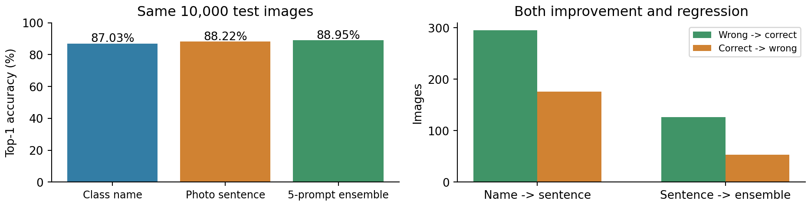
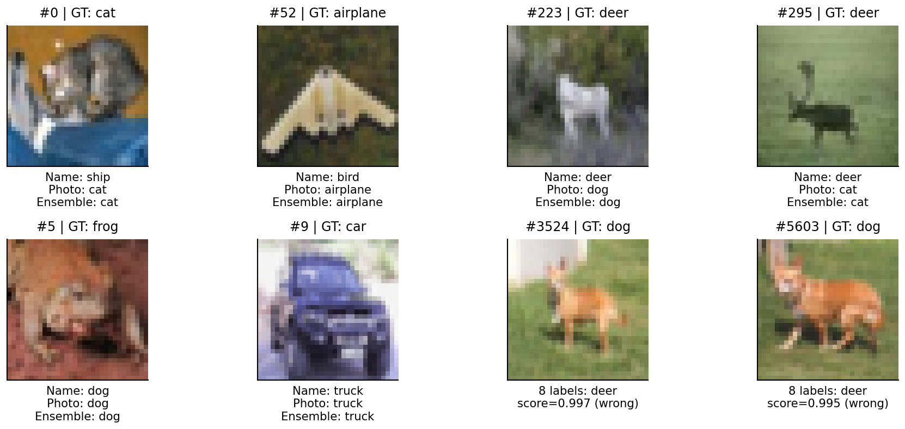
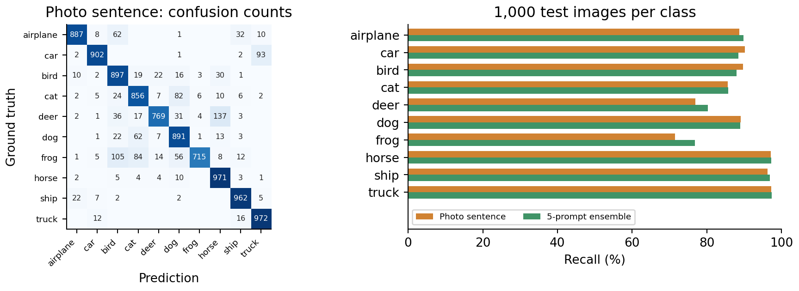
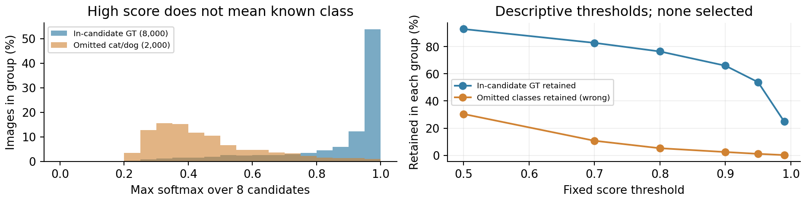

# CLIP Zero-shot 이미지 분류와 프롬프트 비교

**CLIP ViT-B/32를 Colab Tesla T4에서 실행해 CIFAR-10 테스트 이미지 10,000장을 분류했다.** 가중치를 고정하고 같은 이미지에서 클래스명, 사진 설명 문장, 5개 문장 앙상블을 비교했다. Top-1 정확도는 **87.03% → 88.22% → 88.95%**였다.

추가 학습은 **0 epoch**다. 여기서 Zero-shot은 이번 과제의 데이터로 모델을 학습하지 않았다는 뜻이다. CIFAR-10 이미지나 범주가 원래 CLIP 사전학습에 포함됐는지는 확인하지 못했으며, 완전히 낯선 범주에 대한 독립 성능을 주장하지 않는다.

[Colab 노트북 열기](https://colab.research.google.com/github/choi0312/visionai-clip-cifar10/blob/main/notebooks/colab_zero_shot.ipynb)

## 실제 결과

| 고정 프롬프트 조건 | Top-1 | 정답 수 / 10,000 | Top-3 | Macro F1 |
|---|---:|---:|---:|---:|
| 클래스명 `cat` | 87.03% | 8,703 | 97.38% | 0.8702 |
| 사진 설명 `a photo of a cat.` | 88.22% | 8,822 | 97.46% | 0.8815 |
| 5개 문장 앙상블 | 88.95% | 8,895 | 97.71% | 0.8890 |



문장화로 오답 **295장**이 정답이 되고 정답 **176장**이 오답이 돼, 순증은 **119장(+1.19%p)**이었다. 사진 설명에서 앙상블로 바꾸면 **126장 개선·53장 악화**, 순증 **73장(+0.73%p)**이다. 전체 예측 클래스가 달라진 수는 각각 623장, 240장으로, 양쪽에서 모두 틀린 채 클래스만 바뀐 경우도 포함한다. 따라서 평균 개선을 모든 이미지의 개선으로 읽지 않는다. 세 조건은 같은 10,000장의 쌍 비교이며 독립인 30,000장 실험이 아니다.



상단 왼쪽 2장은 문장화로 개선, 오른쪽 2장은 악화한 사례다. 하단 왼쪽은 사진 문장과 앙상블 모두 오답, 오른쪽은 정답인 개를 후보에서 뺀 조건이다. 앞의 세 유형은 원래 테스트 순서에서 중복 없이 처음 2장씩, 후보 누락 유형은 남은 cat/dog 이미지의 최대 점수가 높은 순서로 2장을 선택했다. 그림은 오류 설명을 위한 사후 선택이며 무작위 대표 표본이 아니다. ID와 규칙은 `results/selected_examples.json`에 있다.

## 이미지와 문장을 비교하는 방법

[공식 CLIP 모델](https://huggingface.co/openai/clip-vit-base-patch32)의 이미지 ViT-B/32와 텍스트 Transformer가 각각 512차원 특징을 만든다. 두 벡터를 L2 정규화한 뒤 코사인 유사도에 모델의 `exp(logit_scale)`(이번 체크포인트에서 100)을 곱했다. 최댓값의 클래스를 Top-1 예측으로 삼고, 후보 집합 안에서 softmax를 계산했다. 이미지 특징은 10,000장에 대해 한 번 계산하고 세 조건에 공통 사용했다.

후보 문장은 **추론 전에 고정**했으며 정확도를 보고 문장을 선택하거나 고치지 않았다. 클래스별 문장은 아래와 같고 전체 실제 문자열은 `results/protocol.json`에 있다.

| 조건 | cat 예시 |
|---|---|
| bare | `cat` |
| photo | `a photo of a cat.` |
| ensemble | `a photo of a cat.` / `a blurry photo of a cat.` / `a low resolution photo of a cat.` / `a close-up photo of a cat.` / `a photo of the cat.` |

다른 클래스도 같은 틀을 쓰되 `airplane`에는 `an`을 사용했다. 앙상블은 **각 문장 벡터 정규화 → 클래스 내 5개 벡터 평균 → 평균 벡터 재정규화** 순서다. 5개 softmax의 평균이나 모델 5개를 학습한 결과가 아니다. CIFAR 원래 `automobile` 클래스는 세 조건 모두 `car`로 표기했다.



사진 문장 조건의 frog 재현율은 **71.5%**, 앙상블은 **76.8%**였다. 사진 문장에서 deer→horse 혼동은 **137장**이었다. 혼동행렬의 행은 정답, 열은 예측이고 셀 숫자는 개수다. 각 행의 분모는 1,000장이다. 낮은 원본 해상도와 배경·물체의 모호성을 고려해야 하며 32×32 이미지를 확대해도 잃어버린 세부 정보는 복원되지 않는다.

## 정답이 후보 목록에 없을 때

사진 설명 조건의 저장된 logits에서 **cat·dog 두 열을 제거**하고 남은 8개 후보로 softmax를 다시 계산했다. 정답이 제거된 2,000장과 후보에 정답이 남은 8,000장을 구분했다. 이 cat/dog는 **후보에서 빠진 클래스**이며 사전학습에서 본 적 없는 클래스라는 뜻이 아니다.

- 정답이 빠진 2,000장은 모두 다른 클래스로 강제 분류됐다. 그중 **48장(2.4%)**은 최대 softmax가 0.9 이상이었다.
- 같은 기준에서 후보 안 정답 8,000장 중 **5,282장(66.025%)**만 유지됐고, 그중 5,214장이 맞았다. 기준 미만 2,718장도 자동 처리에서 제외된다.
- 기준 없이 8개 후보에 정답이 남은 이미지의 정확도는 **90.075%**다. 대상과 후보 수가 달라 원래 10종 전체의 88.22%와 직접 비교해 모델 개선이라고 할 수 없다.



0.5·0.7·0.8·0.9·0.95·0.99는 실행 전에 정한 서술용 기준이다. 이 테스트 결과로 운영 임계값을 고르지 않았다. 그림의 유지율은 두 그룹에서 각각 남는 비율이며, 남는 누락 클래스는 여전히 전부 오답이다. **softmax는 현재 후보들 사이의 상대 점수**로, 보정된 정답 확률이나 미지 클래스 검출 확률이 아니다. 이번 실험은 OOD 검출기의 학습·검증이 아니다.

## 데이터와 평가 정의

[공식 CIFAR-10](https://www.cs.toronto.edu/~kriz/cifar.html)의 Python archive에서 `test_batch` 전체를 원래 순서로 사용했다. 10종마다 1,000장, 총 10,000장의 32×32 RGB 이미지다. 훈련 50,000장은 불러오지 않았다. 공식 archive MD5 `c58f30108f718f92721af3b95e74349a`를 검증한 뒤 그 안의 test pickle만 읽는다. SHA-256, 다운로드 최종 URL, 분할·클래스 매핑은 `data/manifest.json`에 있다.

- **Top-1:** 가장 높은 logit의 클래스가 정답인 이미지 수 / 10,000.
- **Top-3:** 높은 logit 3개 안에 정답이 있는 이미지 수 / 10,000.
- **Macro F1:** 클래스마다 `2TP / (2TP + FP + FN)`을 계산한 뒤 10종 평균. 모든 클래스의 정답 수가 1,000장이지만 예측 수는 다를 수 있다.
- 정답 라벨은 지표·사례 분석에만 사용했다. 모델 업데이트, 프롬프트 선택, 임계값 조정, 학습 손실 곡선은 없다.

공개 `results/`에는 세 조건의 실제 **10,000×10 logits**, 라벨·예측·최대 점수 CSV, 텍스트 특징, 혼동행렬, 환경·프로토콜과 검증 기록을 남겼다. 가중치, CIFAR 전체 이미지/훈련 데이터, 전체 이미지 특징은 넣지 않았다. 그림에 필요한 8장만 `example_pixels.npz`에 보관했다.

## 실제 실행 환경

| 항목 | 측정 / 설정 |
|---|---|
| 모델 | `openai/clip-vit-base-patch32`, 151,277,313 parameters |
| revision | `3d74acf9a28c67741b2f4f2ea7635f0aaf6f0268` |
| GPU | Google Colab Tesla T4 |
| Python / 주요 패키지 | 3.13.16 / torch 2.14.1+cu130, torchvision 0.29.1+cu130, Transformers 4.57.1 |
| 기타 패키지 | numpy 2.4.6, Pillow 11.3.0, matplotlib 3.10.0, requests 2.32.4 |
| 정밀도 / batch / seed | float32 / 128 / 42; TF32 비활성 |
| 전처리 | RGB, 짧은 변 224로 bicubic resize, 224×224 center crop, CLIP 평균·표준편차 정규화 |
| 학습 | 0 epoch, `eval()` 및 가중치 gradient 비활성 |
| 텍스트 특징 계산 | 1.26초 |
| 이미지 루프 | **52.97초**: 10,000장, 전처리·전송·GPU forward·정규화·특징 회수 포함 |
| 부분 측정 | 이미지 전처리·전송 28.51초, GPU forward 24.42초 |
| 피크 CUDA allocated | 1,010,001,920 bytes (루프 및 이후 점검 구간) |

시간은 설치·모델/데이터 다운로드·모델 로딩·워밍업·후속 지표/그림 생성을 제외한다. 부분 시간에는 정규화·CPU 특징 회수 등 일부 작업이 빠지므로 합계가 전체와 다르다. 단일 이미지의 서비스 응답 지연이나 범용 처리량으로 일반화하지 않는다. `results/environment.json`에 반올림 전 값이 있다.

캐시 특징으로 계산한 사진 문장 logits를 첫 8장에 대해 `model(**inputs).logits_per_image`와 비교했고 최대 절대 차이는 **0.00004387**이었다. 별도 검증 스크립트가 CSV/logits 일치, 혼동 개수, Top-1/Top-3, TP/FP/FN의 Macro F1, 쌍별 변화, 8후보 softmax·유지율을 재계산해 통과했다. `results/verification.json`에 파일 해시와 점검 항목이 있다.

그림 범례가 막대를 가리지 않도록 로컬 Python 3.12.14·matplotlib 3.10.7에서 저장 logits로 그림을 다시 생성했다. GPU 추론값은 동일하며, 그림 편집 환경은 `results/figure_credits.json`에 기록했다.

## 재현

CUDA PyTorch가 있는 **Python 3.11 이상** 환경에서 실행한다. 실제 실행에는 위 표의 Colab 환경을 사용했다. PyTorch/torchvision은 CUDA와 플랫폼에 맞게 설치하고 torch 2.6 이상을 사용한다. `requirements.txt`는 나머지 직접 사용하는 패키지를 고정했다.

```bash
python -m pip install -r requirements.txt
export VISIONAI_ROOT="$PWD"
python experiments/clip_inference.py
python experiments/analyze_and_plot.py
python experiments/verify_results.py
```

공개 모델이므로 이번 실행에 Hugging Face 토큰은 사용하지 않았다. 최초 실행은 약 170MB의 데이터 archive와 약 605MB의 모델 가중치를 다운로드한다. 플랫폼·라이브러리 차이로 경계 부근의 결과는 조금 달라질 수 있다. 이미 Transformers를 import한 장기 실행 커널에서 패키지를 바꿨다면 커널을 재시작하거나, 노트북처럼 **별도 Python 프로세스로 스크립트를 실행**한다.

모델을 다시 실행하지 않고 저장된 결과만 검증할 수도 있다. NumPy만 있으면 된다.

```bash
python experiments/verify_results.py
# 저장 logits와 8개 예시 픽셀로 도표만 다시 생성 (GPU 불필요)
export VISIONAI_ROOT="$PWD"
python experiments/analyze_and_plot.py
```

Colab CLI에서는 아래 흐름을 사용했다. 설치를 끝내고 새 커널에서 실행하며 작업별 명령이 끝난 뒤 다음 명령을 보낸다.

```bash
colab new -s visionai-week10-clip --gpu T4
colab exec -s visionai-week10-clip -f experiments/colab_setup.py --timeout 300
# 이미 Transformers를 import했다면 colab restart-kernel -s visionai-week10-clip
colab exec -s visionai-week10-clip -f experiments/clip_inference.py --timeout 1500
colab exec -s visionai-week10-clip -f experiments/analyze_and_plot.py --timeout 300
# 결과를 ZIP으로 회수한 다음 종료
colab exec -s visionai-week10-clip -f experiments/package_outputs.py --timeout 60
colab download -s visionai-week10-clip /content/week10-results.zip week10-results.zip
colab stop -s visionai-week10-clip
colab sessions
```

실제 실행일은 **2026-11-08**이고 결과를 회수한 뒤 세션 종료와 활성 세션 없음을 확인했다. 원본 실행 기록에서 필요한 stdout만 `results/inference_stdout.txt`로 남겼다.

## 업무 적용과 한계

상품 임시 태깅과 이미지 검색 후보 생성에 적용할 수 있다. 다만 후보 밖 상품을 강제로 분류하는 문제를 별도로 다뤄야 하며, `기타` 문장 하나를 추가하는 것만으로 해결됐다고 가정하지 않는다. 실제 상품·배경·한글/영어 문장과 후보 구성을 분리한 검증셋에서 클래스별 재현율, 잘못된 자동 승인 비율, 검토 전환 비율과 지연을 측정한다. 운영 기준은 최종 테스트 전에 정하고 태깅 시간과 재검토 비용을 함께 비교한다.

이번 결과는 CIFAR-10의 낮은 해상도·한 번의 고정 프롬프트 실험에 제한된다. 분포가 다른 현장 데이터, 한글 문장, 다중 물체/다중 라벨, 텍스트 검색 품질, 미지 클래스 검출은 평가하지 않았다.

## 출처와 권리

- [Hugging Face CLIP 모델 카드](https://huggingface.co/openai/clip-vit-base-patch32) 및 [고정 revision](https://huggingface.co/openai/clip-vit-base-patch32/tree/3d74acf9a28c67741b2f4f2ea7635f0aaf6f0268)
- [Transformers CLIP 공식 문서](https://huggingface.co/docs/transformers/model_doc/clip)
- [OpenAI CLIP 공식 코드](https://github.com/openai/CLIP)와 [MIT 라이선스](https://github.com/openai/CLIP/blob/main/LICENSE)
- [CIFAR-10 공식 데이터 페이지](https://www.cs.toronto.edu/~kriz/cifar.html), Alex Krizhevsky, Vinod Nair, Geoffrey Hinton
- Alex Krizhevsky, [Learning Multiple Layers of Features from Tiny Images](https://www.cs.toronto.edu/~kriz/learning-features-2009-TR.pdf), 2009

모델 카드에 명시적인 라이선스 태그가 없어 이를 임의로 MIT라고 표기하지 않았다. OpenAI 공식 코드 저장소의 MIT와 모델 카드의 라이선스 메타데이터를 구분한다. 데이터·모델·캡처 그림에 이 저장소의 코드 라이선스를 일괄 적용하지 않는다. 그림별 출처와 변형은 [THIRD_PARTY_NOTICES.md](THIRD_PARTY_NOTICES.md)에 있다.

## AI 도구 활용

코드는 GPT 6.1 Sol 모델을 활용해 작성하고, 코드 검토는 직접 수행했다. 시각화 자료는 GPT 6.1 Sol 모델을 활용해 제작했다. 보고서 내용은 직접 초안을 작성한 뒤 AI의 도움으로 문장과 표현을 다듬었다.
